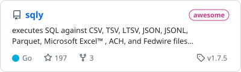
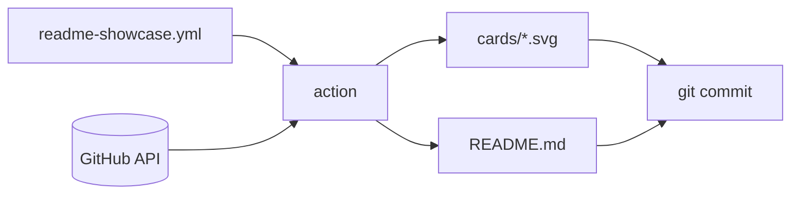
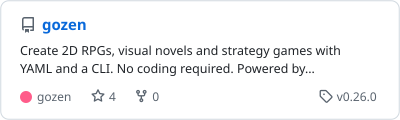
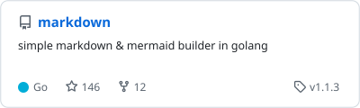
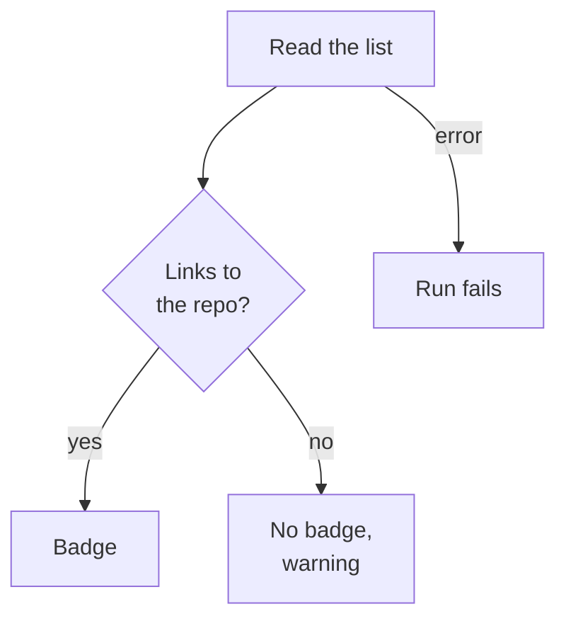
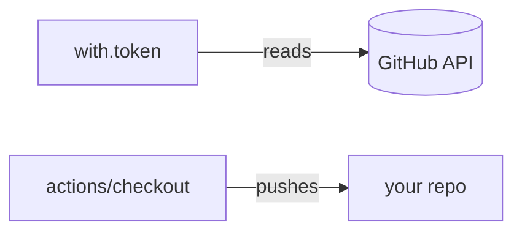
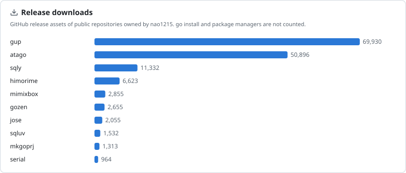
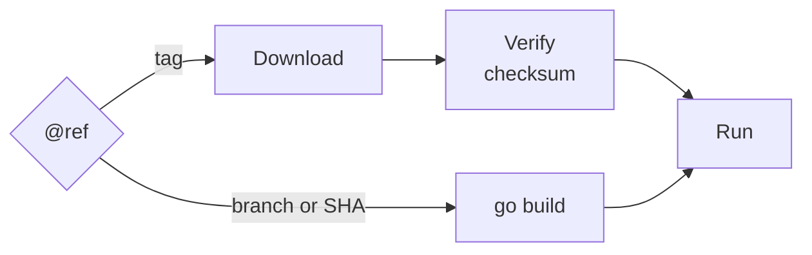

[](https://github.com/nao1215/action-readme-showcase/actions/workflows/unit_test.yml)
[](https://github.com/nao1215/action-readme-showcase/actions/workflows/e2e.yml)
[](https://github.com/nao1215/action-readme-showcase/actions/workflows/action.yml)

[](https://github.com/nao1215/action-readme-showcase/actions/workflows/gitleaks.yml)
[](https://github.com/nao1215/action-readme-showcase/actions/workflows/trivy.yml)
[](https://github.com/nao1215/action-readme-showcase/actions/workflows/govulncheck.yml)
[](https://github.com/nao1215/action-readme-showcase/actions/workflows/gosec.yml)
[](https://github.com/nao1215/atago)
[](https://github.com/marketplace/actions/readme-showcase-cards)
[](https://github.com/nao1215/action-readme-showcase/releases)
[](./LICENSE)
[](https://scorecard.dev/viewer/?uri=github.com/nao1215/action-readme-showcase)


# action-readme-showcase

A GitHub Action that draws repository cards, plus optional star history and release downloads graphs, as SVG files in your own repository, and lists them in your README. Each image has a light and a dark version that follows the reader's theme.

<picture><source media="(prefers-color-scheme: dark)" srcset="doc/img/dark/nao1215__gup.svg"></picture>
<picture><source media="(prefers-color-scheme: dark)" srcset="doc/img/dark/nao1215__sqly.svg"></picture>



## Usage

Put two markers in your README. Each run replaces only what is between them.

```markdown
<!-- showcase:start -->
<!-- showcase:end -->
```

List the repositories in `.github/readme-showcase.yml`:

```yaml
sections:
  - groups:
      - title: Go CLI tools
        repos:
          - name: gup
            featured: true
          - name: sqly
      - title: Libraries
        repos:
          - name: markdown
          - name: golang/go
```

Then add `.github/workflows/readme-showcase.yml`:

```yaml
name: README showcase

on:
  schedule:
    - cron: "17 3 * * *"
  workflow_dispatch:

permissions:
  contents: write

jobs:
  showcase:
    runs-on: ubuntu-latest
    steps:
      - uses: actions/checkout@v7

      - id: showcase
        uses: nao1215/action-readme-showcase@v0

      - if: steps.showcase.outputs.changed == 'true'
        run: |
          git config user.name "github-actions[bot]"
          git config user.email "41898282+github-actions[bot]@users.noreply.github.com"
          git add README.md cards
          git commit -m "docs: update showcase"
          git push
```

Run the workflow once from the Actions tab to fill the README right away. It writes these files next to the README:

```text
cards/
├── light/owner__repo.svg
├── dark/owner__repo.svg
├── star-history-light.svg
├── star-history-dark.svg
├── downloads-light.svg
└── downloads-dark.svg
```

To keep them elsewhere, set `cards-dir` to a directory relative to the README and add the same directory in the commit step:

```yaml
      - id: showcase
        uses: nao1215/action-readme-showcase@v0
        with:
          cards-dir: .github/showcase

      - if: steps.showcase.outputs.changed == 'true'
        run: |
          ...
          git add README.md .github/showcase
```

A card is deleted when its repository leaves the config. Other files in the directory are left alone.

## Cards

Cards come two to a row in the order you list them. These keys change a card:

```yaml
repos:
  - name: gup
    featured: true                              # gold border and a "featured" badge
  - name: gozen
    language: {name: gozen, color: "#ff5c8a"}   # label and dot color instead of GitHub's language
  - name: markdown                              # everything from GitHub
```

<picture><source media="(prefers-color-scheme: dark)" srcset="doc/img/dark/nao1215__gup.svg"></picture>
<picture><source media="(prefers-color-scheme: dark)" srcset="doc/img/dark/nao1215__gozen.svg"></picture>
<picture><source media="(prefers-color-scheme: dark)" srcset="doc/img/dark/nao1215__markdown.svg"></picture>

GitHub reports gozen as Go, but its users write YAML for the gozen engine, so the card shows `gozen` in the engine's color. `description` replaces the text from GitHub in the same way; backticks in it are dropped.

## Sections

Each group gets its title as a heading. A section with a `summary` is folded into `<details>`, like this:

```yaml
sections:
  - summary: More
    groups:
      - title: Libraries
        repos:
          - name: markdown
```

<details><summary>More</summary>

### Libraries

<picture><source media="(prefers-color-scheme: dark)" srcset="doc/img/dark/nao1215__markdown.svg"></picture>

</details>

## Awesome badge

Name the awesome list a repository is in, and its card gets an "awesome" badge next to the title:

```yaml
          - name: sqly
            awesome: avelino/awesome-go
```

<picture><source media="(prefers-color-scheme: dark)" srcset="doc/img/dark/nao1215__sqly.svg"></picture>

On every run the action reads the list's README and looks for a link to `github.com/owner/repo`:



The match ignores case and needs the whole name: `gup` does not match `gup-extra`. The default token can read public lists.

## Star history

```yaml
owner: nao1215
starHistory:
  repos: [gup, sqly] # one line each, in this order
  total: true       # one more line for all public repositories of nao1215
```

<picture><source media="(prefers-color-scheme: dark)" srcset="doc/img/star-history-dark.svg?view=all-public-total"></picture>

A graphed repository needs no card. The graph draws up to six lines, or the total and five repositories.

`total: true` (off by default) adds one line that sums these star histories:

- Counted: every public repository `owner` owns today, including forks and archived repositories, whether or not it is in `repos`.
- Not counted: private repositories and other owners' repositories.
- Not counted, on past dates too: deleted, transferred and now-private repositories.

`owner` defaults to the account that owns the workflow repository, never to the token's account. If any request fails, the run fails instead of publishing a partial total.

Counts come from GitHub's [aggregate star history API](https://docs.github.com/en/rest/activity/starring#get-repository-star-history), which needs Metadata read access and does not read individual stargazers.

Upgrading from v0.1.0: add `starHistory.repos`, because the graph no longer picks repositories through `featured`, and delete `minStars`, which was removed.

### Token setup

`with.token` (the default `github.token` or a PAT) only reads. Pushing uses the credentials from `actions/checkout` and the workflow's `contents: write`:



For public repositories the default `${{ github.token }}` is enough. Do not pass `with.token` from a missing secret: the empty value replaces the default token.

To use a fine-grained personal access token instead (this example graphs `gup`, `sqly`, `filesql` and `markdown` owned by `nao1215`):

1. Open [Fine-grained tokens](https://github.com/settings/personal-access-tokens/new) and set Resource owner to `nao1215`.
2. Under Repository access, select all four graphed repositories. The profile repository `nao1215/nao1215` alone is not enough.
3. Keep Repository permissions at Metadata: Read-only. No write permission is needed.
4. Generate the token and save it as the `STARS_TOKEN` secret of the repository that runs the workflow:

   ```shell
   gh secret set STARS_TOKEN --repo nao1215/nao1215
   ```

5. Pass the secret to the action:

   ```yaml
   - id: showcase
     uses: nao1215/action-readme-showcase@v0
     with:
       token: ${{ secrets.STARS_TOKEN }}
   ```

With `total: true` the PAT must also cover every public repository in the total. After regenerating a token, update the secret and rerun the job.

### If token setup fails

| Symptom | Check |
| --- | --- |
| `set GITHUB_TOKEN or GH_TOKEN` in Actions | `STARS_TOKEN` is nonempty, is a repository secret in the workflow repository, and is passed through `with.token`. |
| HTTP 401 or an access error after expiration | Replace the expired or revoked PAT and update the secret. |
| HTTP 403 from `/stargazers/history` | Check the PAT's resource owner, selected graph repositories, Metadata read permission, and any organization approval requirement. |
| HTTP 403 from `/stargazers` on v0.1.0 | Upgrade to v0.2.0 or later. v0.1.0 uses the restricted individual-stargazer API; adding write permissions is unnecessary with the aggregate API. |

A run makes one GraphQL request, plus REST pages of star history (30 weeks each). With `total: true` it also reads every public repository's history, so large accounts take longer.

## Downloads

```yaml
owner: nao1215
downloads:
  top: 10          # bars to draw, 1 to 20
  position: bottom # below the cards; the default is top
```

<picture><source media="(prefers-color-scheme: dark)" srcset="doc/img/downloads-dark.svg"></picture>

The graph ranks repositories by the downloads of their GitHub release assets, summed over every release. It reads the same repositories as `starHistory.total`: every public repository `owner` owns today, forks and archived ones included. Repositories with no downloads are left out. Installs through `go install`, Homebrew and other package managers never touch a release asset, so they are not counted.

Each repository costs one request per 100 releases, and the default token is enough. If any request fails, the run fails instead of publishing a partial ranking. When the star history is on the same side of the cards, it comes first.

## Config

| Key | Default | Meaning |
| --- | --- | --- |
| `owner` | owner of the repository running the workflow | Owner for names written without `owner/`. |
| `starHistory.repos` | required with `starHistory` | `repo` or `owner/repo` in graph order, independent of cards and `featured`. |
| `starHistory.total` | `false` | Add a line for all public repositories of `owner`. |
| `starHistory.position` | `top` | `top` puts the graph above the cards; `bottom` puts it below them. |
| `downloads.top` | `10` | How many repositories get a bar, 1 to 20. |
| `downloads.position` | `top` | `top` or `bottom`, as for `starHistory.position`. |
| `sections[].summary` | none | Folds the section into `<details>` with this summary. |
| `sections[].groups[].title` | required | Heading above the cards. |
| `repos[].name` | required | `repo` or `owner/repo`. |
| `repos[].description` | GitHub description | Text on the card. Backticks are dropped. |
| `repos[].featured` | `false` | Gold border and a "featured" badge. |
| `repos[].awesome` | none | Awesome list as `owner/repo`; draws the badge while the list links here. |
| `repos[].language` | GitHub primary language | `{name: gozen, color: "#ff5c8a"}` to override the label and dot color. |

A misspelled key is an error. JSON works too, since it is valid YAML.

## Inputs

| Name | Default | Description |
| --- | --- | --- |
| `token` | `${{ github.token }}` | Works for public cards and graphs. See Token setup to supply an optional PAT. |
| `config` | `.github/readme-showcase.yml` | Config file. |
| `readme` | `README.md` | README to rewrite. |
| `cards-dir` | `cards` | Where the SVG files go, relative to the README. |
| `version` | the release the action is referenced at | readme-showcase release to run, such as `v0.1.0` or `latest`. |

## Outputs

| Name | Description |
| --- | --- |
| `changed` | `true` when a card, the graph, or the README changed. |
| `version` | The readme-showcase release that ran. |

## How it runs



A release tag downloads the prebuilt binary for the runner (Linux, macOS or Windows on amd64 or arm64) and checks it against `checksums.txt`; `@v0` is the newest `v0.x.y`. A branch or commit SHA builds from source with the runner's Go.

The binary also runs outside Actions:

```shell
go install github.com/nao1215/action-readme-showcase@latest
GITHUB_TOKEN=$(gh auth token) action-readme-showcase -config .github/readme-showcase.yml
```

On GitHub Enterprise Server, the `GITHUB_API_URL` and `GITHUB_GRAPHQL_URL` variables that Actions sets point it at the server's API.

## Development

```shell
make test       # unit tests
make e2e        # atago specs against a stub GitHub API, no network needed
make coverage   # unit and E2E coverage merged into cover.out
make lint       # golangci-lint, shellcheck, actionlint
```

### Testing

| Technique | Bug class caught here |
|---|---|
| Unit and E2E tests ([main_test.go](main_test.go), [e2e/atago/showcase.atago.yaml](e2e/atago/showcase.atago.yaml)) | A run that writes the wrong files, rewrites the README wrongly, or fails without saying why against a stub GitHub API |
| Golden files ([golden_test.go](golden_test.go)) | A card or star history graph whose SVG changes without anyone deciding it should |
| Property and metamorphic tests ([property_test.go](property_test.go)) | Text cut wider than the card or out of order, a star count or graph scale that goes the wrong way, a README rewrite that is not idempotent |
| Differential tests ([property_test.go](property_test.go)) | Thousands separators that disagree with the digits of `strconv.Itoa` |
| Fuzzing ([fuzz_test.go](fuzz_test.go)) | Malformed SVG, config or README markers that crash or slip through |
| Mutation testing ([.github/workflows/mutation.yml](.github/workflows/mutation.yml)) | A test that runs a changed comparison or coordinate without noticing the change |

How to run each one is in [doc/testing.md](doc/testing.md).

To release, push a `vX.Y.Z` tag. The Release workflow builds the binaries into a draft release. Open the draft, tick "Publish this Action to the GitHub Marketplace", and publish it; that moves the `v0` and `v0.x` tags to the new release.

## License

[MIT](./LICENSE)
