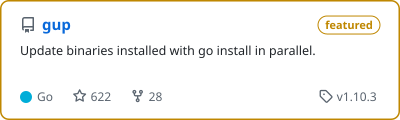
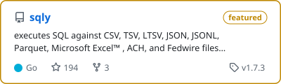
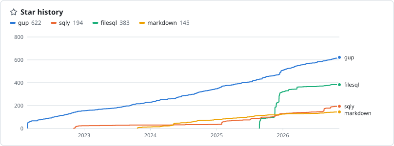
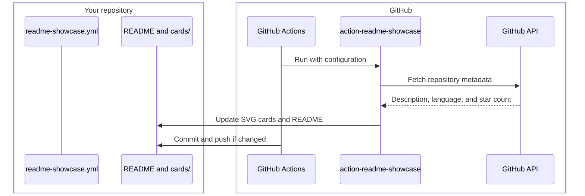

[](https://github.com/nao1215/action-readme-showcase/actions/workflows/unit_test.yml)
[](https://github.com/nao1215/action-readme-showcase/actions/workflows/e2e.yml)
[](https://github.com/nao1215/action-readme-showcase/actions/workflows/action.yml)
[](https://github.com/nao1215/atago)

[](https://scorecard.dev/viewer/?uri=github.com/nao1215/action-readme-showcase)

# action-readme-showcase

A GitHub Action that draws a card for each repository you list, plus an optional star history graph, and puts them in your README.

It needs nothing but GitHub and GitHub Actions. The action reads the GitHub API, writes the cards as SVG files, and your workflow commits them to your own repository. There is no image service to sign up for, and no third-party server the README depends on to show the images. Each card has a light and a dark version, so it follows the reader's GitHub theme.

<picture><source media="(prefers-color-scheme: dark)" srcset="doc/img/dark/nao1215__gup.svg"></picture>
<picture><source media="(prefers-color-scheme: dark)" srcset="doc/img/dark/nao1215__sqly.svg"></picture>

<picture><source media="(prefers-color-scheme: dark)" srcset="doc/img/star-history-dark.svg"></picture>



## Usage

Put two markers in your README. Everything between them is replaced on each run; the rest of the file is left alone.

```markdown
<!-- showcase:start -->
<!-- showcase:end -->
```

List the repositories in `.github/readme-showcase.yml`:

```yaml
sections:
  - groups:
      - title: Go CLI tools
        repos:
          - name: gup
            featured: true
          - name: sqly
      - title: Libraries
        repos:
          - name: markdown
          - name: golang/go
```

Then add `.github/workflows/readme-showcase.yml`:

```yaml
name: README showcase

on:
  schedule:
    - cron: "17 3 * * *"
  workflow_dispatch:

permissions:
  contents: write

jobs:
  showcase:
    runs-on: ubuntu-latest
    steps:
      - uses: actions/checkout@v7

      - id: showcase
        uses: nao1215/action-readme-showcase@v0

      - if: steps.showcase.outputs.changed == 'true'
        run: |
          git config user.name "github-actions[bot]"
          git config user.email "41898282+github-actions[bot]@users.noreply.github.com"
          git add README.md cards
          git commit -m "docs: update showcase"
          git push
```

Run the workflow once from the Actions tab to fill the README right away.

The SVG files go to `cards/` next to the README: `cards/light/`, `cards/dark/`, and the graph as `cards/star-history-light.svg` and `cards/star-history-dark.svg`. To keep them somewhere else, set `cards-dir` to a directory relative to the README, and add the same directory in the commit step:

```yaml
      - id: showcase
        uses: nao1215/action-readme-showcase@v0
        with:
          cards-dir: .github/showcase

      - if: steps.showcase.outputs.changed == 'true'
        run: |
          ...
          git add README.md .github/showcase
```

The action deletes a card when its repository leaves the config. It only touches files named like its cards (`owner__repo.svg`) and its two graph files, so other images in the same directory are safe.

## Star history

List the repositories in `starHistory.repos` to draw their star history, independently of card highlighting. Names use `owner` by default; `owner/repo` also works. Repositories do not need a card. The graph follows the list order and shows up to six repositories.

```yaml
starHistory:
  repos: [gup, sqly]
  total: true
sections:
  ...
```

Set `starHistory.total: true` to add a `total` line showing the combined star history of the repositories in `starHistory.repos`. It is disabled by default. With `total` enabled, the graph shows the total and up to five individual repositories; the total includes selected repositories beyond that display limit. It does not automatically include other repositories owned by the account. This uses the same fetched history and needs no extra API requests or token permissions.

The `minStars` option has been removed. Remove it from existing configurations; every explicitly listed repository is now included.

When upgrading from v0.1.0, add `starHistory.repos` explicitly. The graph no longer selects repositories through `featured`.

The graph uses GitHub's [aggregate star history API](https://docs.github.com/en/rest/activity/starring#get-repository-star-history), which provides daily counts with Metadata read access. It does not read individual stargazers.

### Token setup

For public repositories, the default `${{ github.token }}` works with the aggregate history API. Use the workflow in Usage; no extra secret is required. Do not add `with.token` with a missing secret, because an empty input overrides the default token.

If you want to use a fine-grained personal access token, follow these steps. This example graphs `gup`, `sqly`, `filesql`, and `markdown` owned by `nao1215`.

1. Open [Settings > Developer settings > Fine-grained tokens](https://github.com/settings/personal-access-tokens/new).
2. Give the token a name and choose an expiration date. Set Resource owner to `nao1215` (use your account for your own repositories).
3. Under Repository access, choose Only select repositories and select all four graph repositories. Selecting only the profile repository, `nao1215/nao1215`, is insufficient.
4. Under Repository permissions, keep Metadata: Read-only, which GitHub normally adds automatically. No Contents write permission or User permissions are needed for this graph.
5. Generate the token and copy its value. In the repository running the workflow (`nao1215/nao1215` in this example), open Settings > Secrets and variables > Actions > New repository secret. Use `STARS_TOKEN` as the name and paste the token as its value. Alternatively, run this command and paste the token at the prompt:

   ```shell
   gh secret set STARS_TOKEN --repo nao1215/nao1215
   ```

6. Pass the secret to the action in the workflow:

   ```yaml
   - id: showcase
     uses: nao1215/action-readme-showcase@v0
     with:
       token: ${{ secrets.STARS_TOKEN }}
   ```

When using a PAT, the two repository selections are separate: `starHistory.repos` chooses what to draw; the PAT's Repository access permits those API reads. Update both when adding a graph repository.

The PAT only reads data. Committing the generated files uses the workflow's `permissions: contents: write` and the credentials from `actions/checkout`; it does not need write access on the PAT.

After replacing an expired or regenerated token, update the `STARS_TOKEN` secret in the workflow repository and rerun the failed job. Editing permissions on an existing PAT keeps the same token value.

### If token setup fails

| Symptom | Check |
| --- | --- |
| `set GITHUB_TOKEN or GH_TOKEN` in Actions | `STARS_TOKEN` is nonempty, is a repository secret in the workflow repository, and is passed through `with.token`. |
| HTTP 401 or an access error after expiration | Replace the expired or revoked PAT and update the secret. |
| HTTP 403 from `/stargazers/history` | Check the PAT's resource owner, selected graph repositories, Metadata read permission, and any organization approval requirement. |
| HTTP 403 from `/stargazers` on v0.1.0 | Upgrade to v0.2.0 or later. v0.1.0 uses the restricted individual-stargazer API; adding write permissions is unnecessary with the aggregate API. |

Each run makes one GraphQL request for repository metadata and paginated REST requests for the graph, with up to 30 weeks per page.

## Config

| Key | Default | Meaning |
| --- | --- | --- |
| `owner` | owner of the repository running the workflow | Owner for names written without `owner/`. |
| `starHistory.repos` | required with `starHistory` | Repository names in graph order, independent of cards and `featured`. |
| `starHistory.total` | `false` | Add a `total` line for all selected repositories, including those beyond the individual-line display limit. |
| `sections[].summary` | none | Folds the section into `<details>` with this summary. |
| `sections[].groups[].title` | required | Heading above the cards. |
| `repos[].name` | required | `repo` or `owner/repo`. |
| `repos[].description` | GitHub description | Text on the card. Backticks are dropped. |
| `repos[].featured` | `false` | Gold border and a "featured" badge. |
| `repos[].language` | GitHub primary language | `{name: gozen, color: "#ff5c8a"}` to override the label and dot color. |

Cards come two to a row in the order you list them. A misspelled key is an error rather than being ignored. JSON works too, since it is valid YAML.

## Inputs

| Name | Default | Description |
| --- | --- | --- |
| `token` | `${{ github.token }}` | Works for public cards and graphs. See Token setup to supply an optional PAT. |
| `config` | `.github/readme-showcase.yml` | Config file. |
| `readme` | `README.md` | README to rewrite. |
| `cards-dir` | `cards` | Where the SVG files go, relative to the README. |
| `version` | the release the action is referenced at | readme-showcase release to run, such as `v0.1.0` or `latest`. |

## Outputs

| Name | Description |
| --- | --- |
| `changed` | `true` when a card, the graph, or the README changed. |
| `version` | The readme-showcase release that ran. |

## How it runs

The action downloads the prebuilt `readme-showcase` binary for the runner (Linux, macOS, or Windows on amd64 or arm64) from this repository's release, checks it against `checksums.txt`, and runs it. `@v0` resolves to the newest `v0.x.y` release. Referencing a branch or a commit SHA builds the binary from source with the Go in GitHub's runner images (on PATH, or in the tool cache on macOS).

The binary also runs outside Actions:

```shell
go install github.com/nao1215/action-readme-showcase@latest
GITHUB_TOKEN=$(gh auth token) action-readme-showcase -config .github/readme-showcase.yml
```

On GitHub Enterprise Server, `GITHUB_API_URL` and `GITHUB_GRAPHQL_URL`, which Actions sets, point it at the server's API.

## Development

```shell
make test       # unit tests
make e2e        # atago specs against a stub GitHub API, no network needed
make coverage   # unit and E2E coverage merged into cover.out
make lint       # golangci-lint, shellcheck, actionlint
```

To release, push a `vX.Y.Z` tag. The Release workflow builds the binaries into a draft release. Open the draft, tick "Publish this Action to the GitHub Marketplace", and publish it; that moves the `v0` and `v0.x` tags to the new release.

## License

[MIT](./LICENSE)
