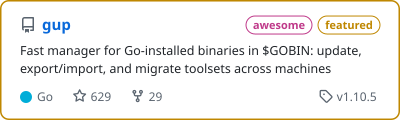

[](https://github.com/nao1215/action-readme-showcase/actions/workflows/unit_test.yml)
[](https://github.com/nao1215/action-readme-showcase/actions/workflows/e2e.yml)
[](https://github.com/nao1215/action-readme-showcase/actions/workflows/action.yml)

[](https://github.com/nao1215/action-readme-showcase/actions/workflows/gitleaks.yml)
[](https://github.com/nao1215/action-readme-showcase/actions/workflows/trivy.yml)
[](https://github.com/nao1215/action-readme-showcase/actions/workflows/govulncheck.yml)
[](https://github.com/nao1215/action-readme-showcase/actions/workflows/gosec.yml)
[](https://github.com/nao1215/atago)
[](https://github.com/marketplace/actions/readme-showcase-cards)
[](https://github.com/nao1215/action-readme-showcase/releases)
[](./LICENSE)
[](https://scorecard.dev/viewer/?uri=github.com/nao1215/action-readme-showcase)

# action-readme-showcase

A GitHub Action that draws a card for each repository you list, plus an optional star history graph, and puts them in your README.

The action reads the GitHub API, writes the cards as SVG files, and your workflow commits them to your own repository, so the README does not depend on an outside image service. Each card has a light and a dark version that follows the reader's GitHub theme.

<picture><source media="(prefers-color-scheme: dark)" srcset="doc/img/dark/nao1215__gup.svg"></picture>
<picture><source media="(prefers-color-scheme: dark)" srcset="doc/img/dark/nao1215__sqly.svg"></picture>

<picture><source media="(prefers-color-scheme: dark)" srcset="doc/img/star-history-dark.svg?view=all-public-total"></picture>

## Usage

Put two markers in your README. Each run replaces what is between them and leaves the rest of the file alone.

```markdown
<!-- showcase:start -->
<!-- showcase:end -->
```

List the repositories in `.github/readme-showcase.yml`:

```yaml
sections:
  - groups:
      - title: Go CLI tools
        repos:
          - name: gup
            featured: true
          - name: sqly
      - title: Libraries
        repos:
          - name: markdown
          - name: golang/go
```

Then add `.github/workflows/readme-showcase.yml`:

```yaml
name: README showcase

on:
  schedule:
    - cron: "17 3 * * *"
  workflow_dispatch:

permissions:
  contents: write

jobs:
  showcase:
    runs-on: ubuntu-latest
    steps:
      - uses: actions/checkout@v7

      - id: showcase
        uses: nao1215/action-readme-showcase@v0

      - if: steps.showcase.outputs.changed == 'true'
        run: |
          git config user.name "github-actions[bot]"
          git config user.email "41898282+github-actions[bot]@users.noreply.github.com"
          git add README.md cards
          git commit -m "docs: update showcase"
          git push
```

Run the workflow once from the Actions tab to fill the README right away.

The SVG files go to `cards/` next to the README: `cards/light/`, `cards/dark/`, and the graph as `cards/star-history-light.svg` and `cards/star-history-dark.svg`. To keep them somewhere else, set `cards-dir` to a directory relative to the README, and add the same directory in the commit step:

```yaml
      - id: showcase
        uses: nao1215/action-readme-showcase@v0
        with:
          cards-dir: .github/showcase

      - if: steps.showcase.outputs.changed == 'true'
        run: |
          ...
          git add README.md .github/showcase
```

When a repository leaves the config, its card is deleted. The action only touches files named like its cards (`owner__repo.svg`) and its two graph files, so other images in the same directory are safe.

## Awesome badge

Name the awesome list a repository appears in, and its card gets an "awesome" badge next to the title:

```yaml
sections:
  - groups:
      - title: Go CLI tools
        repos:
          - name: gup
            featured: true
            awesome: avelino/awesome-go
```

On each run the action reads the list's README through the GitHub API and draws the badge only if it links to `github.com/owner/repo` (case-insensitive; `gup` does not match `gup-extra`). If the link is gone, the card loses the badge and the run prints a warning. If the list cannot be read, the run fails rather than dropping badges. Each list is read once however many cards name it, and the default `${{ github.token }}` can read public lists.

## Star history

List the repositories to graph in `starHistory.repos`, as `repo` (under `owner`) or `owner/repo`. They do not need a card, and `featured` has no effect on the graph. Lines follow the list order, up to six repositories.

```yaml
owner: nao1215
starHistory:
  repos: [gup, sqly] # individual lines
  total: true       # all public repositories owned by nao1215
sections:
  ...
```

`starHistory.total: true` (off by default) adds a `total (all public)` line: the combined star history of every public repository `owner` owns now, whether or not it is in `repos` or has a card. The graph names the owner and states this scope.

| Setting | Scope |
| --- | --- |
| `starHistory.repos` | Individual lines, in the listed order. `owner/repo` can select another owner's repository. |
| `starHistory.total: true` | All public repositories owned by `owner`, including repositories absent from `repos` and the cards. Includes forks and archived repositories; excludes private repositories and other owners' repositories. |

With `total` on, the graph shows the total and up to five individual lines; the limit does not apply to what the total counts. For example, `repos: [gup, sqly]` with `owner: nao1215` shows those two lines plus the total for all of nao1215's public repositories. `owner` defaults to the account that owns the workflow repository and is never inferred from the token or from `repos`.

The total adds up GitHub's daily histories of the repositories that are public today, so deleted, transferred and now-private repositories are missing from past dates too. If any listing or history request fails, the run fails instead of publishing a partial total.

The graph uses GitHub's [aggregate star history API](https://docs.github.com/en/rest/activity/starring#get-repository-star-history), which returns daily counts with Metadata read access and does not read individual stargazers.

Upgrading from v0.1.0: add `starHistory.repos`, since the graph no longer picks repositories through `featured`, and delete `minStars`, which has been removed (every listed repository is included).

### Token setup

For public repositories the default `${{ github.token }}` is enough, and the workflow in Usage needs no extra secret. Do not pass `with.token` from a secret that does not exist: the empty input overrides the default token.

To use a fine-grained personal access token instead, follow these steps. The example graphs `gup`, `sqly`, `filesql`, and `markdown` owned by `nao1215`.

1. Open [Settings > Developer settings > Fine-grained tokens](https://github.com/settings/personal-access-tokens/new).
2. Name the token, pick an expiration date, and set Resource owner to `nao1215` (your own account for your repositories).
3. Under Repository access, choose Only select repositories and select all four graphed repositories. The profile repository `nao1215/nao1215` alone is not enough.
4. Under Repository permissions, keep Metadata: Read-only, which GitHub usually adds itself. The graph needs no Contents write or User permissions.
5. Generate and copy the token. In the repository that runs the workflow (`nao1215/nao1215` here), open Settings > Secrets and variables > Actions > New repository secret and save it as `STARS_TOKEN`, or run this and paste the token at the prompt:

   ```shell
   gh secret set STARS_TOKEN --repo nao1215/nao1215
   ```

6. Pass the secret to the action in the workflow:

   ```yaml
   - id: showcase
     uses: nao1215/action-readme-showcase@v0
     with:
       token: ${{ secrets.STARS_TOKEN }}
   ```

With `total: true` the action also reads the histories of all of `owner`'s public repositories, so a PAT limited to the graphed repositories is not enough: its Metadata read access must cover every public repository in the total.

The PAT only reads. The commit step uses the workflow's `permissions: contents: write` and the credentials from `actions/checkout`.

After replacing an expired or regenerated token, update the `STARS_TOKEN` secret and rerun the failed job. Editing the permissions of an existing PAT keeps the same token value.

### If token setup fails

| Symptom | Check |
| --- | --- |
| `set GITHUB_TOKEN or GH_TOKEN` in Actions | `STARS_TOKEN` is nonempty, is a repository secret in the workflow repository, and is passed through `with.token`. |
| HTTP 401 or an access error after expiration | Replace the expired or revoked PAT and update the secret. |
| HTTP 403 from `/stargazers/history` | Check the PAT's resource owner, selected graph repositories, Metadata read permission, and any organization approval requirement. |
| HTTP 403 from `/stargazers` on v0.1.0 | Upgrade to v0.2.0 or later. v0.1.0 uses the restricted individual-stargazer API; adding write permissions is unnecessary with the aggregate API. |

Each run makes one GraphQL request for card and graph metadata, plus paginated REST history requests of up to 30 weeks per page. With `total: true` it also lists all public repositories (100 per page) and fetches their histories, reusing those already fetched for individual lines, so accounts with many repositories take more requests and time.

## Config

| Key | Default | Meaning |
| --- | --- | --- |
| `owner` | owner of the repository running the workflow | Owner for names written without `owner/`. |
| `starHistory.repos` | required with `starHistory` | Repository names in graph order, independent of cards and `featured`. |
| `starHistory.total` | `false` | Add `total (all public)` for all public repositories owned by `owner`, including forks and archived repositories, independently of `starHistory.repos`. |
| `sections[].summary` | none | Folds the section into `<details>` with this summary. |
| `sections[].groups[].title` | required | Heading above the cards. |
| `repos[].name` | required | `repo` or `owner/repo`. |
| `repos[].description` | GitHub description | Text on the card. Backticks are dropped. |
| `repos[].featured` | `false` | Gold border and a "featured" badge. |
| `repos[].awesome` | none | An awesome list as `owner/repo`, such as `avelino/awesome-go`. The card shows an "awesome" badge while that list's README links to the repository. |
| `repos[].language` | GitHub primary language | `{name: gozen, color: "#ff5c8a"}` to override the label and dot color. |

Cards come two to a row in the order you list them. A misspelled key is an error. JSON works too, since it is valid YAML.

## Inputs

| Name | Default | Description |
| --- | --- | --- |
| `token` | `${{ github.token }}` | Works for public cards and graphs. See Token setup to supply an optional PAT. |
| `config` | `.github/readme-showcase.yml` | Config file. |
| `readme` | `README.md` | README to rewrite. |
| `cards-dir` | `cards` | Where the SVG files go, relative to the README. |
| `version` | the release the action is referenced at | readme-showcase release to run, such as `v0.1.0` or `latest`. |

## Outputs

| Name | Description |
| --- | --- |
| `changed` | `true` when a card, the graph, or the README changed. |
| `version` | The readme-showcase release that ran. |

## How it runs

The action downloads the prebuilt `readme-showcase` binary for the runner (Linux, macOS, or Windows on amd64 or arm64) from this repository's release, checks it against `checksums.txt`, and runs it. `@v0` resolves to the newest `v0.x.y` release. A branch or commit SHA reference builds the binary from source with the Go in GitHub's runner images (on PATH, or in the tool cache on macOS).

The binary also runs outside Actions:

```shell
go install github.com/nao1215/action-readme-showcase@latest
GITHUB_TOKEN=$(gh auth token) action-readme-showcase -config .github/readme-showcase.yml
```

On GitHub Enterprise Server, the `GITHUB_API_URL` and `GITHUB_GRAPHQL_URL` variables that Actions sets point it at the server's API.

## Development

```shell
make test       # unit tests
make e2e        # atago specs against a stub GitHub API, no network needed
make coverage   # unit and E2E coverage merged into cover.out
make lint       # golangci-lint, shellcheck, actionlint
```

### Testing

| Technique | Bug class caught here |
|---|---|
| Unit and E2E tests ([main_test.go](main_test.go), [e2e/atago/showcase.atago.yaml](e2e/atago/showcase.atago.yaml)) | A run that writes the wrong files, rewrites the README wrongly, or fails without saying why against a stub GitHub API |
| Golden files ([golden_test.go](golden_test.go)) | A card or star history graph whose SVG changes without anyone deciding it should |
| Property and metamorphic tests ([property_test.go](property_test.go)) | Text cut wider than the card or out of order, a star count or graph scale that goes the wrong way, a README rewrite that is not idempotent |
| Differential tests ([property_test.go](property_test.go)) | Thousands separators that disagree with the digits of `strconv.Itoa` |
| Fuzzing ([fuzz_test.go](fuzz_test.go)) | Malformed SVG, config or README markers that crash or slip through |
| Mutation testing ([.github/workflows/mutation.yml](.github/workflows/mutation.yml)) | A test that runs a changed comparison or coordinate without noticing the change |

How to run each one is in [doc/testing.md](doc/testing.md).

To release, push a `vX.Y.Z` tag. The Release workflow builds the binaries into a draft release. Open the draft, tick "Publish this Action to the GitHub Marketplace", and publish it; that moves the `v0` and `v0.x` tags to the new release.

## License

[MIT](./LICENSE)
